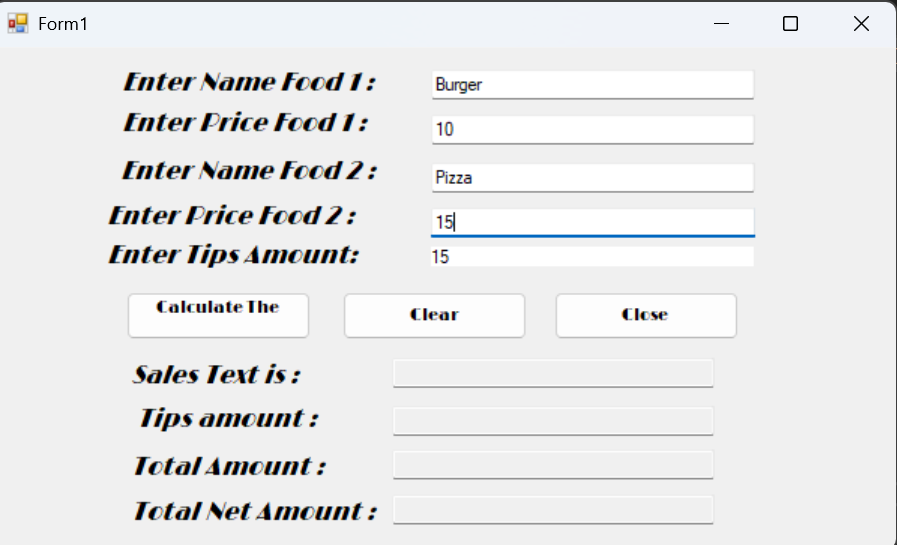
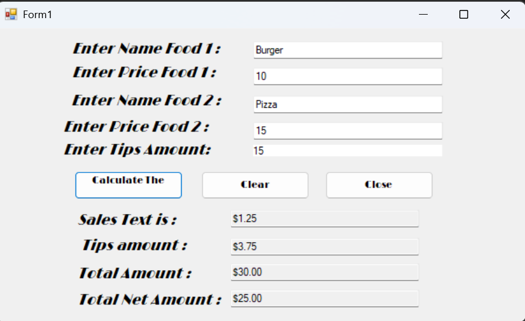
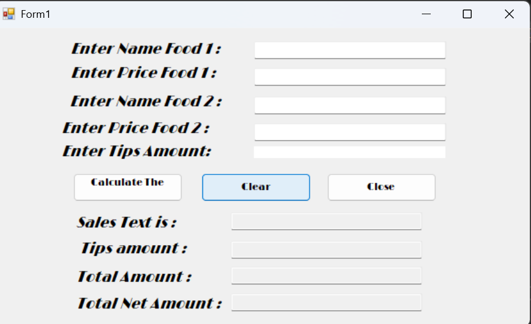

# Chapter 2: Food Price Calculator

- sidoo yahay inta calculate button la taaban

## Sida Program-ku u shaqeeyo

- **Calculate The Price:** Marka la taabto, wuxuu xisaabiyaa qiimaha labada cunto, Sales Tax, Tips Amount, Total Amount iyo Total Net Amount, kadibna natiijooyinka ayuu TextBox-yada ku soo bandhigayaa.

- **Clear:** Marka la taabto, wuxuu tirtiraa dhammaan xogta ku jirta TextBox-yada.

- **Close:** Marka la taabto, wuxuu xirayaa program-ka.

- **Sales Tax:** Wuxuu muujinayaa lacagta canshuurta ee lagu daray qiimaha cuntada.

- **Tips Amount:** Wuxuu xisaabiyaa lacagta tip-ka iyadoo lagu saleynayo boqolkiiba la geliyay.

- **Total Amount:** Wuxuu isku daraa qiimaha cuntada, Sales Tax iyo Tips Amount.

- **Total Net Amount:** Wuxuu muujinayaa qiimaha cuntada kadib marka laga saaro Sales Tax iyo Tip.

## Controls-ka la isticmaalay

- **Label:** Waxaa loo isticmaalay qoraallada sharaxaaya meelaha xogta lagu geliyo.
- **TextBox:** Waxaa loo isticmaalay in lagu geliyo qiimaha iyo magaca cuntada, sidoo kale lagu soo bandhigo natiijooyinka.
- **Button:** Waxaa loo isticmaalay Calculate, Clear iyo Close.
